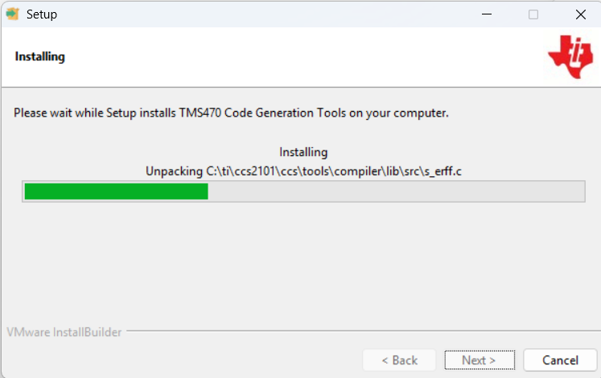
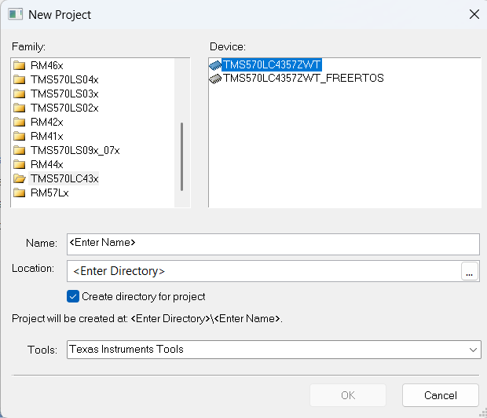
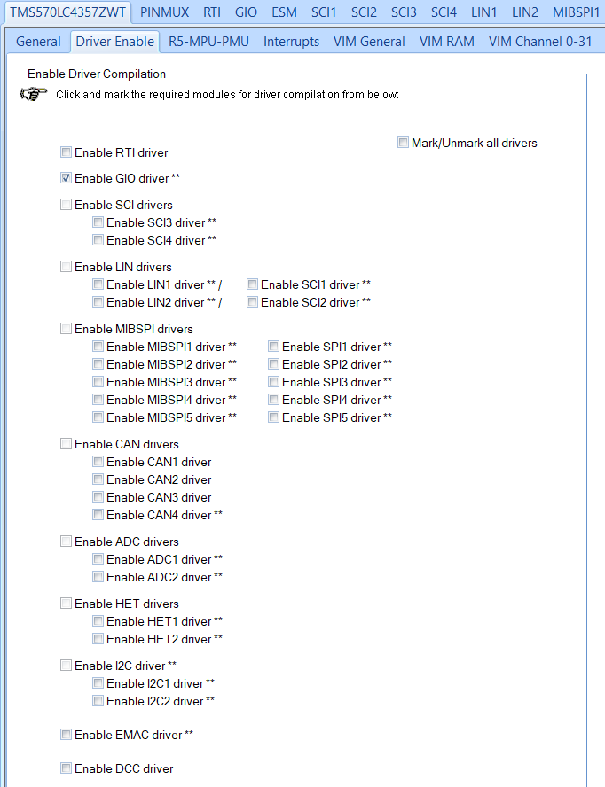
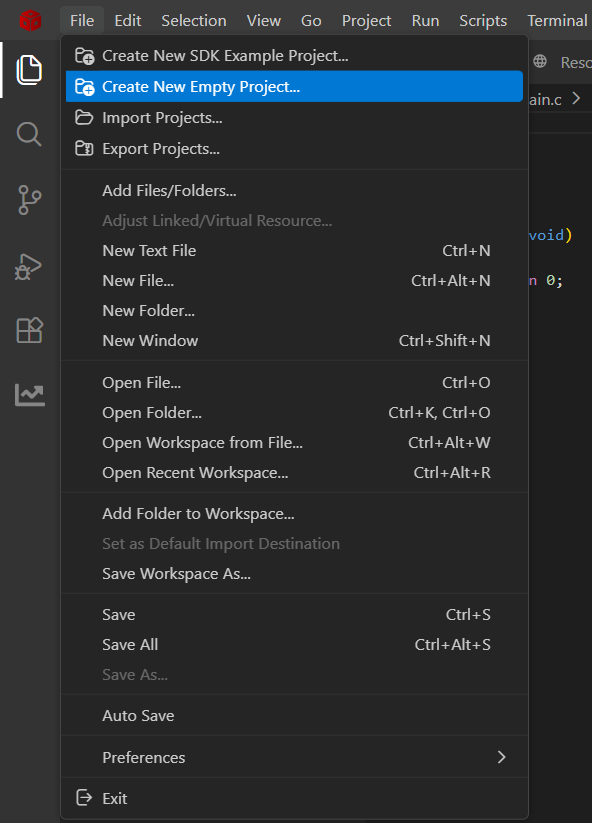
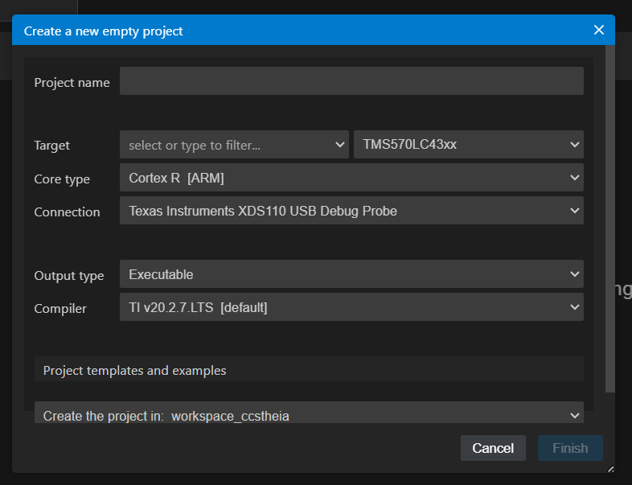
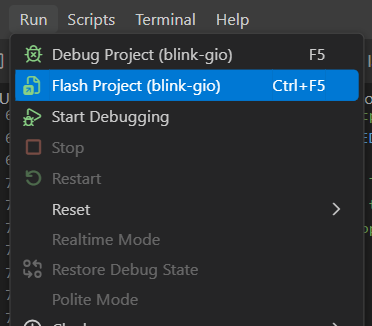

# Setup guide: HALCoGen + Code Composer Studio 21 + LAUNCHXL2-570LC43

An end-to-end walkthrough for a first-time user: install the tools, generate a
project with HALCoGen, build it in Code Composer Studio (CCS), and flash the
LaunchPad. It was written against these versions:

| Tool | Version |
|------|---------|
| Code Composer Studio | 21.0.1 (Theia-based, VS Code style) |
| HALCoGen | 04.07.01 |
| TI Arm Compiler (`ti-cgt-arm`) | 20.2.7.LTS |
| Board | LAUNCHXL2-570LC43 (TMS570LC4357ZWT) |

**If you only want to run the example in this repo**, do steps 1 and 2, then
jump to [Run the example from this repo](#run-the-example-from-this-repo).
Steps 3 to 6 explain how that project was created, for when you build your own.

## How the pieces fit

- **HALCoGen** is a code generator. You choose the device and peripherals in a
  GUI, and it writes the start-up code and drivers (`source/` and `include/`).
- **CCS** is the IDE: it compiles that code, connects to the board, flashes it
  and debugs it.
- HALCoGen's own examples are loose `.c` files, in
  `C:\ti\Hercules\HALCoGen\v04.07.01\examples\TMS570LC43x\`. That is why CCS
  shows no TMS570 example projects: you generate a project first.

## 1. Install the tools

1. Install **Code Composer Studio 21.0.1**.
2. Install **HALCoGen 04.07.01** (the Hercules HALCoGen installer from TI).
3. Install the classic **TI Arm Compiler 20.2.7.LTS** (step 2).
4. Connect the LaunchPad with a micro-USB cable. The on-board XDS110 debug
   probe powers the board and appears as a USB device.

## 2. Install the classic TI Arm compiler

CCS 21 ships only the newer `armllvm` compiler. HALCoGen 04.07.01 generates
start-up code for the classic TI Arm compiler (`armcl`), so install that one
next to it.

1. Download the **TI Arm Compiler 20.2.7.LTS** Windows installer
   (`ti_cgt_tms470_20.2.7.LTS_windows-x64_installer`) from ti.com.
2. Run it and point it at the CCS compilers folder:

   

   The compiler must end up in its **own subfolder**:

   ```
   C:\ti\ccs2101\ccs\tools\compiler\ti-cgt-arm_20.2.7.LTS
   ```

   If the installer unpacks directly into `...\tools\compiler\` (so `bin`,
   `include` and `lib` sit beside `ti-cgt-armllvm_5.1.1.LTS`), CCS will not find
   it. In that case create the `ti-cgt-arm_20.2.7.LTS` folder and move `bin`,
   `include`, `lib`, `man` and the other new files into it.
3. Restart CCS. The compiler now appears in the project wizard as
   **TI v20.2.7.LTS**.

## 3. Create the project in HALCoGen

1. In HALCoGen choose **File > New > Project**.
2. Family **TMS570LC43x**, device **TMS570LC4357ZWT** (not the `_FREERTOS`
   variant), tools **Texas Instruments Tools**.

   
3. Set the name and location. Untick *Create directory for project* if the
   location is already the folder you want.
4. Open the **Driver Enable** tab. Untick **Mark/Unmark all drivers**, then tick
   only the drivers you need. For the first example that is **GIO**.

   
5. Press **F5** (or *File > Generate Code*). HALCoGen writes `source/` and
   `include/` next to the `.hcg` file and reports that code generation is
   complete.

HALCoGen does **not** create CCS project files, so the next step builds them.

## 4. Create the CCS project

1. In CCS choose **File > Create New Empty Project...**

   
2. Fill in the wizard:

   

   - **Project name:** your project name.
   - **Target:** the exact chip, `TMS570LC4357ZWT`, with `TMS570LC43xx` as the
     family.
   - **Core type:** Cortex R [ARM].
   - **Connection:** Texas Instruments XDS110 USB Debug Probe.
   - **Output type:** Executable.
   - **Compiler:** TI v20.2.7.LTS.
   - **Create the project in:** a folder of your choice.
3. Click **Finish**. The wizard adds a placeholder `main.c`; delete it, because
   HALCoGen's `HL_sys_main.c` already contains `main()`.

## 5. Add the generated code to the CCS project

1. Link (do not copy) the HALCoGen `source` and `include` folders into the
   project with **File > Add Files/Folders...**, so regenerating in HALCoGen
   updates the build.
2. Add the HALCoGen `include` folder to the compiler include path in the
   project's build settings.
3. Put your application code inside the `USER CODE BEGIN` and `USER CODE END`
   markers of `HL_sys_main.c`. HALCoGen keeps code inside those markers when you
   regenerate.

This repository already contains such a project, with the links and include
path set, in `examples/00-blink-gio/ccs/`.

## 6. Build and flash

1. Build with **Project > Build** (or the hammer icon) and fix any errors.
2. Flash with **Run > Flash Project**, or press **Ctrl+F5**:

   

   **Run > Debug Project** (**F5**) flashes and starts a debug session instead.
3. After flashing, press the board's reset button to start the program from the
   beginning.

## Run the example from this repo

1. Complete steps 1 and 2.
2. Clone this repository.
3. In CCS choose **File > Import Projects...** and select
   `examples/00-blink-gio/ccs`. When asked, choose **Import projects at their
   original locations**. This keeps the project in the repository, so its
   relative links to `halcogen/` keep working.
4. Build, then flash as in step 6.

Expected result: one LED blinks, and a second LED lights while a user button is
held. See the [example README](../examples/00-blink-gio/README.md).

## Troubleshooting

| Symptom | Likely cause |
|---------|--------------|
| Only `armllvm` offered as compiler | The classic compiler is not in its own `ti-cgt-arm_20.2.7.LTS` subfolder, or CCS was not restarted |
| Many `HL_*.h` not found errors | The HALCoGen `include` folder is missing from the compiler include path |
| `main` defined twice | The wizard's placeholder `main.c` was not deleted |
| Cannot connect to the target | The USB cable is charge-only, or the XDS110 driver is missing; check Device Manager |
| Regenerating removed your code | The code was outside the `USER CODE` markers |

## Documents

TI's documents are not redistributed here. Download them from TI:

- [LAUNCHXL2-570LC43 tool page](https://www.ti.com/tool/LAUNCHXL2-570LC43#tech-docs):
  the development kit's quick start guide, schematic and layout, and user
  documents.
- [TMS570LC4357 product page](https://www.ti.com/product/TMS570LC4357#tech-docs):
  the datasheet (SPNS195), the Technical Reference Manual (SPNU563), and
  application notes.
