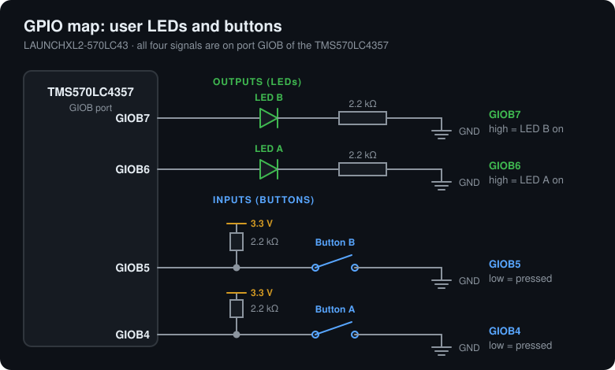

# 00 – Blink with GIO

**Topic:** GIO outputs and inputs
**Board:** LAUNCHXL2-570LC43 (TMS570LC4357ZWT)

## What it shows
The smallest complete program: HALCoGen-generated start-up code, the GIO driver,
one LED blinking, and a second LED that follows a user button. It also proves
the toolchain, the XDS110 connection, and flashing.

## Tools
- HALCoGen 04.07.01
- Code Composer Studio 21.0.1
- TI Arm Compiler 20.2.7.LTS

## HALCoGen configuration
- Device TMS570LC4357ZWT, TI tools.
- Driver Enable: GIO only.
- Application code lives in the `USER CODE` sections of
  `halcogen/source/HL_sys_main.c`, so regenerating does not overwrite it.

## Pins
| Function | Pin |
|----------|-----|
| LED A (blinks) | GIOB6 |
| LED B (follows buttons) | GIOB7 |
| User button A | GIOB4 (active low) |
| User button B | GIOB5 (active low) |

Pins taken from the LaunchPad schematic: the LEDs are driven by GIOB6 and GIOB7,
and the buttons connect GIOB4 and GIOB5 to ground when pressed.

## Behavior
LED A blinks about once per second. LED B is on while either user button is held.

## Notes
- The board pulls each button pin up to 3.3 V through a 2.2 kΩ resistor (see the
  diagram), so the code needs no pull-up configuration. Tested on the board:
  both buttons work without enabling the internal pull-ups.
- Timing uses a busy-wait loop and is approximate. `01-rti-blinky` replaces it
  with a timer interrupt.
- To build, import `ccs/` into CCS (*Import projects at their original
  locations*). See `docs/setup.md`.
