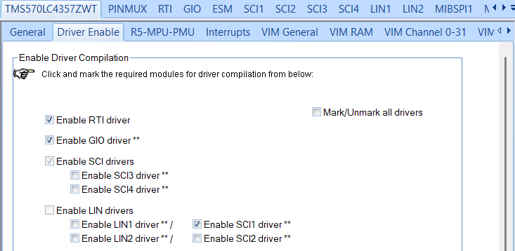
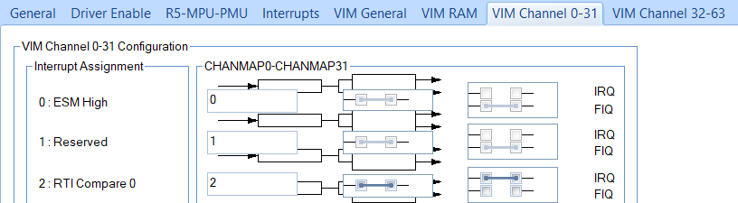
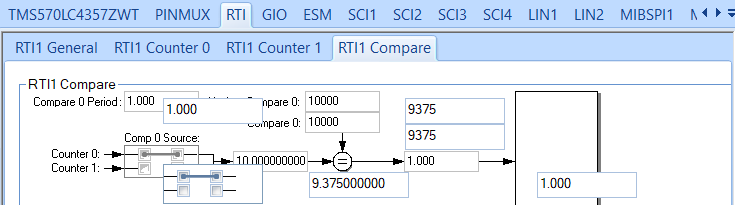
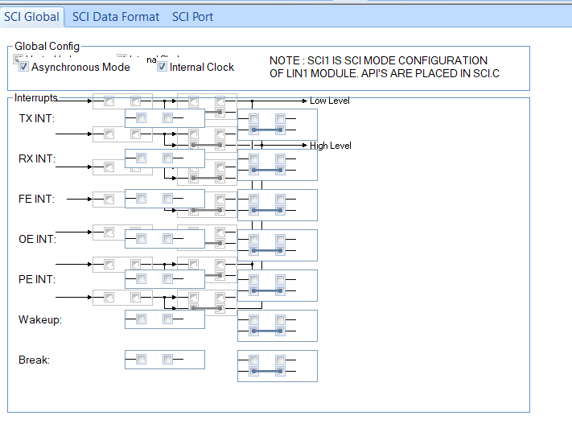
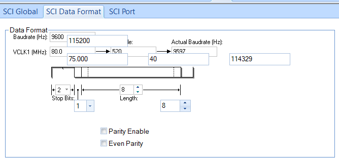

# 01 – RTI tick and live telemetry

**Topic:** RTI timer interrupt, interrupt timing, SCI telemetry
**Board:** LAUNCHXL2-570LC43 (TMS570LC4357ZWT)
**Status:** builds and links with TI Arm Compiler 20.2.7.LTS; not yet run on the board

## What it shows
`00-blink-gio` timed everything with a busy-wait. Here a 1 kHz interrupt from
the RTI drives the program, and the interrupt measures itself:

- **Latency:** how long after the RTI compare match the handler starts running,
  read from the RTI's own counter, at a resolution of 107 ns.
- **Duration:** how many CPU cycles the handler takes, read from the Cortex-R5F's
  PMU cycle counter.
- **CPU load:** the share of CPU time spent in the handler and in main-loop work.

A hundred times a second the main loop sends these values, with the LEDs and
buttons, as a line of CSV text over the XDS110 virtual COM port. A telemetry
viewer such as Radian plots them live; any serial terminal shows the raw lines.

The two user buttons load the CPU in two different ways, so you can see the
difference between **load** and **latency**:

| Hold | What the main loop does, once per tick | What the telemetry shows |
|------|----------------------------------------|--------------------------|
| Button A | Masks IRQs for 50 µs, starting 20 µs before the tick is due (a critical section that is too long) | `irq_lat_max_ns` jumps to about 30 000; `cpu_load_pct` rises by about 5 |
| Button B | 400 µs of busy work with IRQs enabled | `cpu_load_pct` rises by about 40; latency does not move |

## Tools
- HALCoGen 04.07.01
- Code Composer Studio 21.0.1
- TI Arm Compiler 20.2.7.LTS

## HALCoGen configuration
Device TMS570LC4357ZWT, TI tools. Starting from `00-blink-gio`'s project:

| Where in HALCoGen | Setting |
|-------------------|---------|
| TMS570LC4357ZWT → Driver Enable | RTI, SCI1 and GIO drivers on |
| TMS570LC4357ZWT → VIM Channel 0-31 | Channel 2 (`rtiCompare0Interrupt`) enabled, IRQ |
| RTI → RTI1 Compare | Compare 0 from Counter 0, period 1.000 ms (Counter 0 at its default 9.375 MHz) |
| SCI1 → SCI Global | Asynchronous mode, internal clock, no interrupts |
| SCI1 → SCI Data Format | 115200 baud, 8 data bits, 1 stop bit, parity off |

### Step by step
Open the project's `.hcg` file in HALCoGen (**File → Open → Project**), then:

1. **TMS570LC4357ZWT → Driver Enable:** tick *Enable RTI driver*, keep *Enable
   GIO driver*, and under *Enable LIN drivers* tick *Enable SCI1 driver* only.
   SCI1 is the SCI mode of the LIN1 module, which is why it is listed there.

   

2. **TMS570LC4357ZWT → VIM Channel 0-31:** enable channel 2, *RTI Compare 0*,
   as an IRQ. Leave channel 0, *ESM High*, as it is (FIQ).

   

3. **RTI → RTI1 Compare:** compare 0 from Counter 0, *Compare 0 Period* 1.000 ms.
   With Counter 0 at its default 9.375 MHz, HALCoGen computes a compare value
   of 9375.

   

4. **SCI1 → SCI Global:** *Asynchronous Mode* and *Internal Clock* ticked, every
   interrupt left off; the code polls.

   

5. **SCI1 → SCI Data Format:** *Baudrate* 115200, *Stop Bits* 1 (the default is
   2), *Length* 8, *Parity Enable* off. HALCoGen shows the actual rate it can
   reach: 114329 baud, 0.8 % low, which any PC serial port accepts. Leave the
   *SCI Port* tab at its defaults.

   

6. **File → Generate Code**, then **File → Save**. Code between the USER CODE
   markers is kept.

The overlapping boxes in the screenshots are how HALCoGen draws at some display
scaling settings; the values are what count.

### What the code uses

- `rtiInit()`, `rtiEnableNotification()` and `rtiStartCounter()` start the tick.
  HALCoGen's `rtiCompare0Interrupt()` clears the flag and calls
  `rtiNotification()`, which `app/tick.c` supplies in place of HALCoGen's weak,
  empty one.
- `sciInit()`, `sciIsTxReady()`, `sciSendByte()`, `sciIsRxReady()`,
  `sciReceiveByte()` and `sciRxError()` run the serial port, polled.
- `systemInit()` sets the clocks: GCLK 300 MHz, VCLK 75 MHz, RTICLK 75 MHz.
  `app/app_config.h` reads them from `HL_system.h`.
- The PMU functions in `HL_sys_pmu.asm` start and read the cycle counter.
- The GIO driver, as in `00-blink-gio`.

## Layout
```
app/
  app_config.h    pins, rates, serial port, load sizes
  tick.c/.h       RTI compare 0 at 1 kHz; latency and duration per tick
  uart.c/.h       SCI at 115200 8N1; ring buffer drained by polling
  telemetry.c/.h  the channel table; header and data lines
halcogen/         HALCoGen project; main() is in source/HL_sys_main.c
ccs/              CCS project; links halcogen/source, halcogen/include and app/
```

## Pins
| Function | Pin |
|----------|-----|
| LED A (blinks at 1 Hz) | GIOB6 |
| LED B (on while a button is held) | GIOB7 |
| User button A (latency load) | GIOB4 (active low) |
| User button B (CPU load) | GIOB5 (active low) |
| Telemetry TX / RX | SCI1 (LIN1TX / LIN1RX), to the XDS110 virtual COM port |

## Telemetry format
115200 baud, 8 data bits, no parity, 1 stop bit. One header line, then one data
line every 10 ms. Fields are separated by commas and lines end in CR LF:

```
t_ms,seq,led_a,led_b,btn_a,btn_b,irq_lat_min_ns,irq_lat_max_ns,isr_cycles_max,cpu_load_pct,test_sine,lines_dropped,samples_missed
10,0,0,0,0,0,...
20,1,0,0,0,0,...
```

| Channel | Unit | Meaning |
|---------|------|---------|
| `t_ms` | ms | Device time since reset, at the end of the 10 ms window. Use it as the time column. |
| `seq` | count | Window number. A gap means a line was lost somewhere. |
| `led_a`, `led_b` | 0/1 | LED states. |
| `btn_a`, `btn_b` | 0/1 | 1 while the button is held. |
| `irq_lat_min_ns`, `irq_lat_max_ns` | ns | Shortest and longest tick interrupt latency in the window. |
| `isr_cycles_max` | CPU cycles | Longest tick handler body in the window (300 cycles = 1 µs). |
| `cpu_load_pct` | % | Busy share of the CPU over the window, one decimal. |
| `test_sine` | – | 0.5 Hz sine computed on the FPU, three decimals. A smooth signal to check a plot by eye. |
| `lines_dropped` | count | Lines discarded because the transmit buffer was full. |
| `samples_missed` | count | Windows the main loop did not take in time. |

The header is sent once after reset, and again whenever the board receives a
byte, so a host that connects late can send any key to get the channel names.
Nothing else is ever printed: no banner and no log lines. A host that learns the
channels from the first line it sees then always sees either the header or data.

## Run it
1. Build and flash as in `00-blink-gio` (import `ccs/` into CCS; see
   `docs/setup.md`).
2. Open the XDS110 **Application/User UART** COM port (Windows Device Manager
   lists it under Ports) at 115200 8N1, in a serial terminal or in Radian.
3. Press the LaunchPad's reset button so the header arrives first, or send any
   character to ask for it.
4. Hold button A, then button B, and watch the latency and load channels.

In Radian, take the time from the first column, in milliseconds. That way the
plot follows the board's clock, not the time the bytes reach the PC.

## How the measurements work
**Latency.** Compare 0 fires when the RTI free-running counter FRC0 reaches
COMP0, and in the same cycle the RTI adds the period (UDCP0) to COMP0. So in the
notification, `COMP0 - UDCP0` is the counter value at the match, and
`FRC0 - (COMP0 - UDCP0)` is the time it took to get there. That includes VIM
dispatch, exception entry, HALCoGen's handler up to the `rtiNotification()`
call (its register save includes the FPU registers), and any time IRQs were
masked. FRC0 advances once every CPUC0 + 1 RTI clocks; `tick.c` reads the
prescaler that HALCoGen set (8, so 9.375 MHz), and one count is 107 ns.

**Duration.** `rtiNotification()` reads the PMU cycle counter at its first and
last statements. HALCoGen's handler around it is not included.

**CPU load.** The main loop is a super-loop. A pass that does something (sends
a line, moves bytes to the SCI, runs injected load) counts its cycles as busy,
minus any tick-interrupt cycles that fell inside it. A pass that finds nothing
to do counts as idle. Load is (busy cycles + interrupt cycles) / window cycles.

## Notes
- **Serial port.** SCI1 (LIN1) has dedicated pins and needs no pin
  multiplexing. If no text arrives, check the LaunchPad schematic for the UART
  that reaches the XDS110. To use SCI3, enable its driver, set it up like
  SCI1 and route it to balls N2 and W3 in HALCoGen's PINMUX tab, regenerate,
  and set `APP_SCI` to `sciREG3` in `app/app_config.h`.
- **Faster telemetry.** A line is about 60 bytes. 100 lines a second use about
  half of 115200 baud. For more, lower `APP_TICKS_PER_SAMPLE` and raise the
  baud rate in HALCoGen's SCI1 tab together; watch `lines_dropped`.
- **Finer latency.** For a resolution of 26.7 ns instead of 107 ns, give RTI
  Counter 0 a higher frequency in HALCoGen (prescale 2, 37.5 MHz) and keep the
  compare 0 period at 1.000 ms. `tick.c` reads the new prescaler by itself.
- **IRQ stack.** HALCoGen gives the IRQ mode 256 bytes of stack. The tick
  interrupt's deepest path uses about 160 bytes in a Debug build: 96 bytes for
  HALCoGen's handler, most of it the saved FPU registers, plus
  `rtiNotification()`, the tick hook and the GIO calls. Keep the tick hook
  small, or raise the IRQ stack size in HALCoGen and regenerate.
- **Debugger.** The RTI stops while the CPU is halted (`RTIGCTRL.COS` = 0), so
  a breakpoint does not leave a backlog of ticks.
