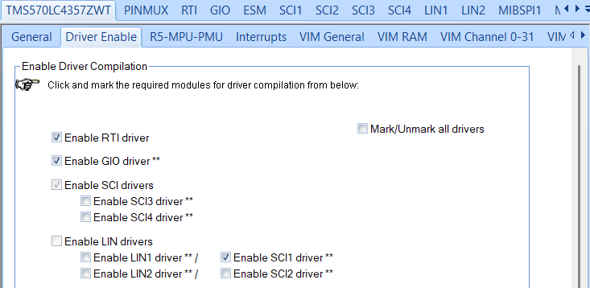
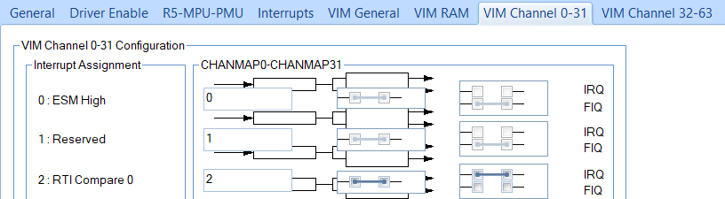
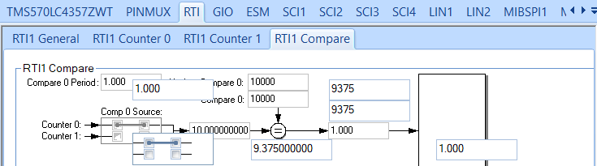
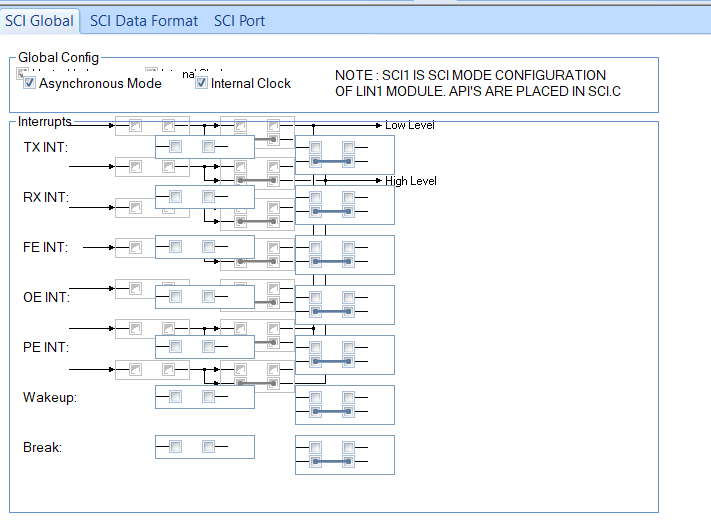
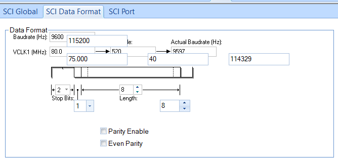

# 02 – ESM fault injection

**Topic:** Error Signaling Module, flash ECC and the EPC, CPU lockstep (CCM-R5F)
**Board:** LAUNCHXL2-570LC43 (TMS570LC4357ZWT)
**Status:** builds and links with TI Arm Compiler 20.2.7.LTS; runs on the board (both injections detected, nERROR released after 1 s)

## What it shows
The TMS570LC43x is built to detect its own faults. This example causes two
real ones on purpose, at the press of a button, and shows the chip catching each
one, while the program keeps running and streams what happened over the serial
port.

| Press | Fault injected | What the chip does | What you see |
|-------|----------------|--------------------|--------------|
| Button A | One bit of one flash read flips on its way to the CPU | The CPU's SECDED logic corrects the bit; the Error Profiling Controller (EPC) records the address; the ESM sets group 1 channel 4 | LED B toggles; `ecc_injected` and `ecc_detected` count up; `ecc_read_ok` reads 1 |
| Button B | The two lockstep CPUs are made to look different for one cycle | The CPU Compare Module (CCM-R5F) reports a compare error; the ESM sets group 2 channel 2, interrupts with an FIQ and drives the ERROR pin low | The **ERR** LED lights for 1 s; `ccm_detected` counts up; `nerror` is 1 for 1 s |

LED A keeps blinking at 1 Hz through all of it: neither fault stops the program.

TI's out-of-box demo on this LaunchPad includes the same two injections. This
example does them in code you can read, with every register write traced to
the Technical Reference Manual (SPNU563A) and the datasheet (SPNS195C).

## Tools
- HALCoGen 04.07.01
- Code Composer Studio 21.0.1
- TI Arm Compiler 20.2.7.LTS

## HALCoGen configuration
The same HALCoGen settings as `01-rti-telemetry`: RTI, SCI1 and GIO drivers
on, VIM channel 2 enabled, compare 0 at 1.000 ms, SCI1 at 115200 8N1, shown
step by step below. One addition in a USER CODE section of
`HL_sys_link.cmd`: a `.ramfunc` section that is stored in flash and copied to
RAM at start-up (see *Flash ECC injection* below).

### Step by step
Open the project's `.hcg` file in HALCoGen (**File → Open → Project**), then:

1. **TMS570LC4357ZWT → Driver Enable:** tick *Enable RTI driver*, keep *Enable
   GIO driver*, and under *Enable LIN drivers* tick *Enable SCI1 driver* only.
   SCI1 is the SCI mode of the LIN1 module, which is why it is listed there.

   

2. **TMS570LC4357ZWT → VIM Channel 0-31:** enable channel 2, *RTI Compare 0*,
   as an IRQ. Leave channel 0, *ESM High*, as it is (FIQ).

   

3. **RTI → RTI1 Compare:** compare 0 from Counter 0, *Compare 0 Period* 1.000 ms.
   With Counter 0 at its default 9.375 MHz, HALCoGen computes a compare value
   of 9375.

   

4. **SCI1 → SCI Global:** *Asynchronous Mode* and *Internal Clock* ticked, every
   interrupt left off; the code polls.

   

5. **SCI1 → SCI Data Format:** *Baudrate* 115200, *Stop Bits* 1 (the default is
   2), *Length* 8, *Parity Enable* off. HALCoGen shows the actual rate it can
   reach: 114329 baud, 0.8 % low, which any PC serial port accepts. Leave the
   *SCI Port* tab at its defaults.

   

6. **File → Generate Code**, then **File → Save**. Code between the USER CODE
   markers is kept.

The overlapping boxes in the screenshots are how HALCoGen draws at some display
scaling settings; the values are what count.

### What the code uses
Besides the RTI and SCI drivers, used as in 01:
- `esmInit()` (start-up): clears the ESM, sets the ERROR pin low time.
- `esmHighInterrupt()`: the FIQ for ESM group 2. It clears the flag and calls
  `esmGroup2Notification()`, which HALCoGen declares weak; `app/fault.c`
  supplies the real one.
- `epcEnableSERREvent()`: lets the EPC report new correctable errors to the ESM.
- `_mpuSetRegion...()`: open the MPU window for the RAM routine.
- `esmTriggerErrorPinReset()`: releases the ERROR pin.

## Layout
```
app/
  app_config.h    pins, rates, serial port, ERROR pin hold time, EPC behavior
  fault.c/.h      the two injections, the ESM bookkeeping, the RAM routine
  tick.c/.h       1 kHz RTI tick and the 10 ms telemetry windows
  uart.c/.h       SCI1 at 115200 8N1; ring buffer drained by polling
  telemetry.c/.h  the channel table; header and data lines
halcogen/         HALCoGen project; main() is in source/HL_sys_main.c
ccs/              CCS project; links halcogen/source, halcogen/include and app/
```

## Pins
| Function | Pin |
|----------|-----|
| LED A (heartbeat, 1 Hz) | GIOB6 |
| LED B (toggles on each reported ECC error) | GIOB7 |
| ERR LED | nERROR, driven by the ESM |
| User button A (flash ECC error) | GIOB4 (active low) |
| User button B (lockstep compare error) | GIOB5 (active low) |
| Telemetry TX / RX | SCI1, to the XDS110 virtual COM port |

## Telemetry
Same format as `01-rti-telemetry`: 115200 8N1, a header line, then a CSV line
every 10 ms with device time in ms first. Send any byte to get the header again.

| Channel | Meaning |
|---------|---------|
| `t_ms`, `seq` | Device time (ms) and line number, as in 01 |
| `btn_a`, `btn_b` | 1 while the button is held |
| `nerror` | 1 while the ESM drives the ERROR pin low (ERR LED on) |
| `ecc_injected` | Flash single-bit errors injected |
| `ecc_detected` | EPC correctable error reports seen (ESM group 1, channel 4) |
| `ecc_read_ok` | 1 if the last corrupted read still returned the true data |
| `epc_cam_used` | Addresses the EPC currently remembers, of 32 |
| `ccm_injected` | Lockstep compare errors forced |
| `ccm_detected` | CPU compare errors reported by the FIQ (ESM group 2, channel 2) |
| `ccm_selftest_flags` | The CCM's second reporting path seen (ESM group 1, channel 31) |
| `ccm_detect_cycles` | CPU cycles from forcing the error to entering the notification in the FIQ (300 cycles = 1 µs) |
| `esm_unexpected` | Group 2 errors this program did not inject. Should stay 0. |
| `esm_boot_g1`, `esm_boot_g2` | ESM group 1 (channels 0-31) and group 2 flags found set at start-up, as bits, before they were cleared (bit n is channel n: 4 is group 2 channel 2, the CCM compare error) |
| `esm_unexpected_ch`, `epc_first_addr` | Diagnostics: see *Notes* |
| `lines_dropped`, `samples_missed` | As in 01 |

## Run it
1. Build and flash as in `00-blink-gio` (import `ccs/` into CCS).
2. Open the XDS110 Application/User UART at 115200 8N1, then reset the board.
3. Press button A a few times, then button B.

Each press of A should add one to `ecc_injected` and `ecc_detected` and toggle
LED B. Each press of B should add one to `ccm_injected`, `ccm_detected` and
`ccm_selftest_flags`, and light the ERR LED for a second.

## How it works

### Flash ECC injection
Every 64 bits of flash carry 8 bits of ECC, and the Cortex-R5F checks them on
every read; the check is permanently enabled (TRM 2.2.3.2). The flash controller has
a diagnostic mode for testing exactly this (TRM 7.7.2.2, *ECC Data Correction
Diagnostic Test Mode*, DIAGMODE 7). It XORs the values in `FEMU_DMSW` and
`FEMU_DLSW` into the data of the next flash read before the data reaches the
CPU. `fault.c` flips data bit 0 and leaves the stored ECC alone, which is
exactly what a single-bit fault in the flash array looks like. The CPU
computes syndrome CEh, decodes it to data bit 0 (TRM Table 7-2), flips the bit
back and reports the address on its event bus.

Two rules from the TRM shape the code:
- *Branch to a non-Flash region to execute this sequence.* The diagnostic
  corrupts only one flash access. If an instruction fetch from flash came
  between the trigger and the read, it would use that access up. So the
  routine, `Fault_FlashEccRead()`, is linked into `.ramfunc`, copied to RAM with
  `copy_in()`, calls nothing, and runs with IRQ and FIQ masked.
- *Make sure the address is not already cached.* The routine invalidates the
  data cache line before the read, so every press reaches the flash.

HALCoGen's MPU setup makes RAM non-executable (region 3). `Fault_Init()` opens
MPU region 15 as a 256-byte window over exactly the copied routine:
non-cacheable and writable for the copy, then read-only and executable. The
linker aligns the routine to 256 bytes for this, and `Fault_Init()` checks that
it fits.

### The EPC
The Error Profiling Controller remembers up to 32 addresses that had a
correctable error (TRM 12.2.2). A new address is reported to the ESM. An
address it already knows is corrected again but **not** reported. This stops a
single weak bit in a loop from flooding the ESM. With `APP_EPC_FORGET_ADDRESS`
set to TRUE (the default), `fault.c` removes the address after each report, so
every press is reported. Set it to FALSE to see the EPC at work: the first
press is reported, and later ones only raise `ecc_injected`, while
`epc_cam_used` stays at 1.

### Lockstep compare error
The two Cortex-R5F cores run the same code in lockstep, and the CCM-R5F
compares their outputs every cycle. Writing key 9h to `CCMKEYR1` selects error
forcing mode (TRM 13.2.1.3, Table 13-9). For one cycle the CCM is fed two
different patterns, so its error output fires for real, and then it switches
back to lockstep by itself. The ESM receives it on two paths: group 2 channel 2
("CCM-R5F CPU compare") and group 1 channel 31 ("CCM-R5F self-test").

A group 2 error always does two things:
- **FIQ.** The ESM enters `esmHighInterrupt()` as an FIQ, which calls
  `esmGroup2Notification()`. That function records the time and the CPU cycles
  since the forcing.
- **ERROR pin.** The ESM drives the ERROR pin low for at least its low time:
  16384 VCLK cycles, about 218 µs (TRM 16.2.2). The main loop waits
  `APP_NERROR_HOLD_MS` so the ERR LED is visible, then writes key 5 to `ESMEKR`
  to release the pin.

## Notes
- **Unexpected errors.** If any group 2 error arrives that this program did not
  inject, `esm_unexpected` counts it and the ERROR pin is never released again.
  The program does not hide a real fault.
- **Errors before `main()`.** HALCoGen's start-up runs `esmInit()` after a
  power-on, external or debug reset only; after other resets the ESM's flags,
  its ERROR pin and the EPC's CAM are as the previous run left them, and any
  error raised during start-up is still pending too. Without care these would
  reach the FIQ as unexpected errors as soon as it is enabled and hold the
  ERROR pin low for good. `Fault_Init()` records the flags it finds
  (`esm_boot_g1`, `esm_boot_g2`), clears them, empties the EPC CAM and
  releases the pin before interrupts are enabled.
- **No unprogrammed flash near the code.** The flash loader's Auto ECC
  Generation writes ECC only for the bytes it programs. The CPU also reads
  flash nothing was programmed into: a cache line fill or prefetch runs past
  the end of the image (the ECC target is the last thing in flash) and into
  the holes between sections, the largest the one between `.ovly` and the
  256-byte aligned `.ramfunc`. Erased flash has no valid ECC, so those reads
  raised ESM group 2 channel 3 (a fatal bus error) at every boot and on every
  press of A, which held the ERROR pin low for good. `HL_sys_link.cmd`
  therefore cuts FLASH0 to the first 256 KB and fills it and VECTORS with
  0xFFFFFFFF: every byte there is programmed, and Auto ECC Generation (leave
  it on) writes valid ECC for all of it.
  - The two `fill` lines and FLASH0's shorter length are outside HALCoGen's
    USER CODE blocks: apply them again after generating code with HALCoGen.
  - The program must fit in those 256 KB (it uses about 29 KB); a section that
    spills into FLASH1 gets no fill around it.
  - Linker-generated ECC (`--ecc=on` with `vfill`) would cover all of flash,
    but CCS 21's loader did not program it ("region is not writable", then a
    verification error at 0xF0407FF0).
- **Diagnostic columns.** `esm_unexpected_ch` has bit n set for each group 2
  channel n that raised an unexpected error; `epc_first_addr` is the address in
  the first occupied EPC CAM entry (0 if none), so a correctable error nobody
  injected says where it was.
- **First bytes after reset.** A reset can cut the line being sent short. The
  program sends a line end before its header, so the header always starts a
  line of its own and a host reads it.
- **KILL OSC button.** The LaunchPad's KILL OSC button shorts the oscillator.
  The clock monitor catches it and the HF LPO replaces the oscillator and the
  PLL (TRM 14.4.2). That changes VCLK, so the serial baud rate and the
  telemetry stop being valid. It is not part of this example.
- **Event bus export.** The CPU reports ECC errors to the EPC only when its
  event bus export is on. HALCoGen's start-up turns it on after a power-on reset
  only, so `Fault_Init()` turns it on again.
- **Stacks.** Deepest paths in a Debug build: the FIQ about 112 of its 256
  bytes, the RTI IRQ about 145 of 256.
- **Only on a development board.** These are diagnostics that a safety
  application runs in a controlled way at start-up or in a test window, not
  something to trigger in a running system.
